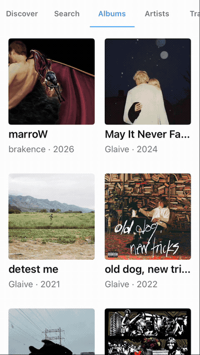
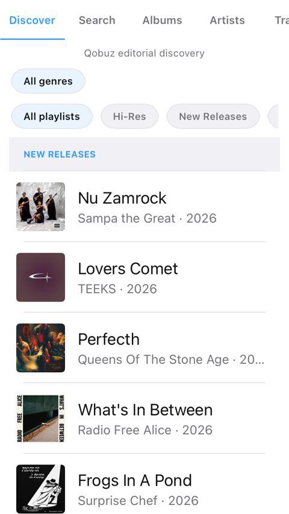
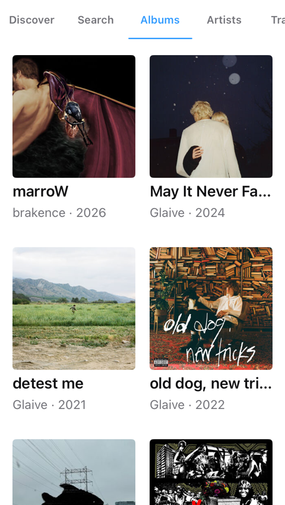
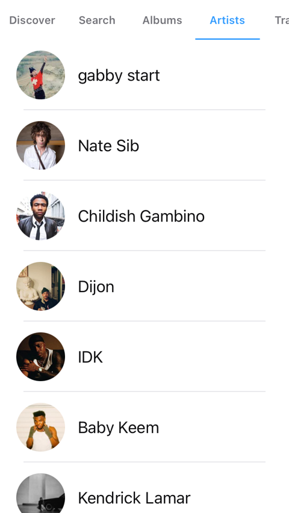
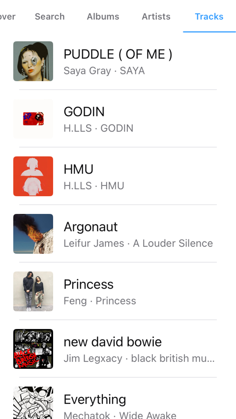
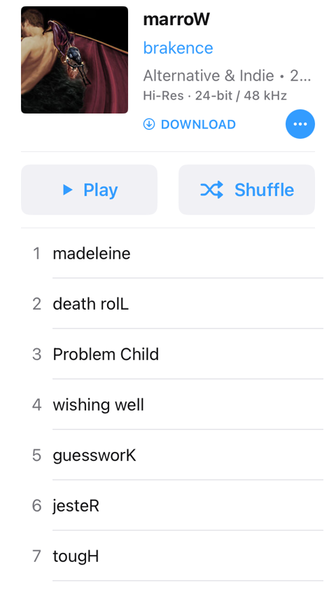
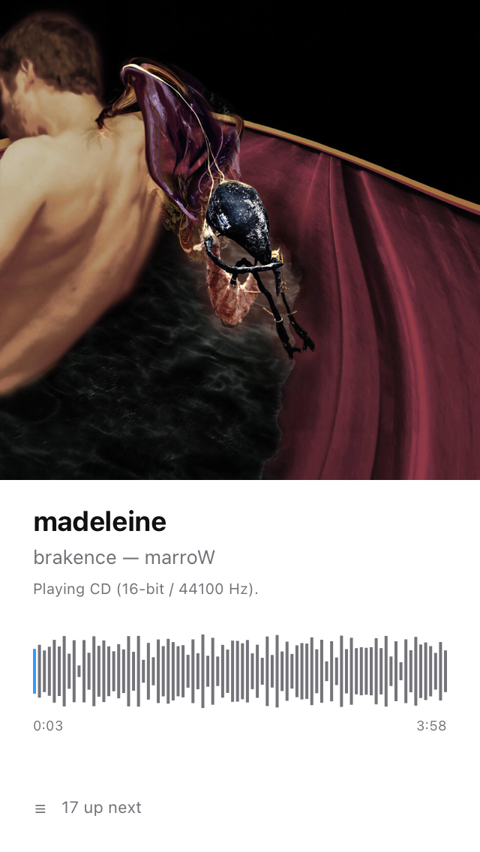
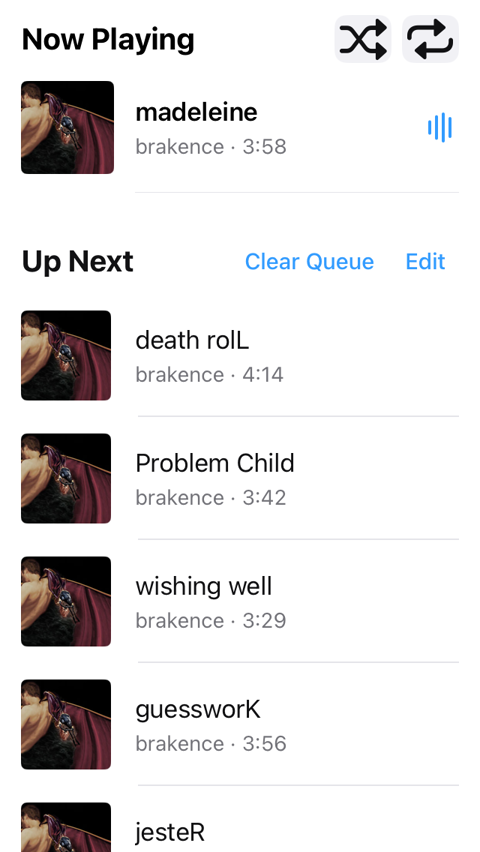
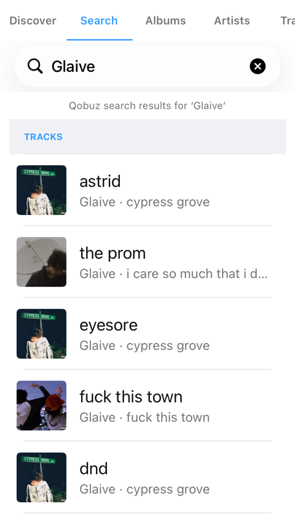

# Music for iPod touch

A native UIKit music player for the **iPod touch (6th generation)** running iOS 12.5.8,
with Qobuz as its catalogue and streaming source.

The app targets the iPod's 320 × 568 pt portrait screen and is built to feel like the
player that should have shipped with it: a compact tab strip, saved-library browsing,
a waveform player, an editable queue, offline downloads, parametric EQ profiles, and a
true-black dark mode.



> Recorded from the real app against a live Qobuz account in the iOS Simulator using the
> iPod 320 × 568 preview window, sped up to 1.5×. Playback is genuine streaming, not mocked.
> Full-speed MP4: [`media/video/demo-tour-full.mp4`](media/video/demo-tour-full.mp4).

## Screenshots

| Discover | Albums | Artists |
| :---: | :---: | :---: |
|  |  |  |

| Tracks | Album detail | Now playing | Up Next |
| :---: | :---: | :---: | :---: |
|  |  |  |  |

| Search |
| :---: |
|  |

## Features

- **Qobuz as the only source.** No local file import, indexing, or fallback library. The
  catalog, the saved library, artwork, and audio all come from Qobuz.
- **Saved-library browsing.** Albums, artists, and tracks read from your Qobuz favorites
  with real pagination, local search, and A–Z / Z–A sorting.
- **Editorial discovery.** New Releases, Qobuzissims, Ideal Discography, Album of the
  Week, Most Streamed, and Press Awards, plus genre- and tag-filtered playlists.
- **Album and artist pages.** Tracklists, play/shuffle, add-to-library, artist releases,
  and playable top tracks.
- **In-app streaming playback.** FLAC/MP3 streaming through `AVPlayer` with request
  signing, quality selection (MP3, CD, Hi-Res 96, Hi-Res 192), and a live waveform.
- **Queue control.** Reorder, clear, and tap any Up Next row to make it the now-playing
  item.
- **Offline downloads.** Persistent download records with progress, cancellation, and an
  offline-only library view that ends automatically when the connection returns.
- **Parametric EQ.** AutoEQ / Equalizer APO `ParametricEQ.txt` profiles applied to
  playback through an `MTAudioProcessingTap` biquad cascade, with per-profile toggles.
- **Audio-path diagnostics.** A settings report showing the delivered stream format, the
  rate the EQ actually runs at, the session rate, and whether the route is resampling.
- **True-black dark mode**, a light theme, and an automatic theme that follows the time
  of day.
- **iPod-shaped UI.** Five tabs that scroll horizontally on narrow screens, custom 78 pt
  rows, a two-column artwork grid, edge-swipe tab navigation, and a 320 × 568 preview mode
  for running on larger simulators.

## Requirements

| | |
| :--- | :--- |
| Xcode | 26.x (built and tested with 26.6) |
| Deployment target | iOS 12.0 |
| Device | iPod touch 6th gen (`iPod7,1`), iOS 12.5.8 — also runs in the Simulator |
| Qobuz account | A paid Qobuz subscription is required for streaming |

## Build and run

The Xcode project is generated from `ios/Music/project.yml`:

```sh
brew install xcodegen        # once
cd ios/Music
xcodegen generate
```

Then either open `ios/Music/Music.xcodeproj` in Xcode, or use the script, which picks the
best available small-screen simulator, builds, installs, and launches:

```sh
./run-simulator.sh
```

On simulators that are not an iPod touch or iPhone SE (1st gen), the script passes
`-ipod-preview`, which centers the app in a 320 × 568 pt window so layouts are exercised at
the real iPod size.

### Signing in

Launch the app and tap **Continue with Qobuz** to run the OAuth flow in the browser. The
token is stored in the system Keychain, never in preferences.

For personal device builds you can pre-seed a session by placing a credentials file in the
app bundle. This is read once at launch and is **gitignored** — do not commit it:

```sh
# ios/Music/QobuzPersonalCredentials.json
{
  "importID": "<any-unique-string>",
  "credentials": { "userAuthToken": "<token>", "userID": 1234567 }
}
```

`tools/qobuz-signin.py` performs the browser sign-in and writes this file without ever
printing the token.

### Tests

```sh
cd ios/Music
xcodebuild test -project Music.xcodeproj -scheme Music \
  -destination 'platform=iOS Simulator,name=iPhone 16'
```

`MusicTests` covers the request signing, catalog mapping, pagination, queue behavior, EQ
biquad math, download lifecycle, offline mode, and layout geometry at 320 and 375 points.
`MusicUITests` covers navigation, tab preferences, and the iPod preview viewport.

Two suites are opt-in and skipped by default, because they need a real account:

```sh
# Screenshots of every major screen -> media/screenshots
TEST_RUNNER_QOBUZ_DEMO_DIR="$PWD/media/screenshots" xcodebuild test-without-building ...

# A slow, camera-friendly tour to record with `simctl io recordVideo`, then
# speed it up and build the GIF -> media/demo.gif
TEST_RUNNER_QOBUZ_DEMO_TOUR=1 xcodebuild test-without-building ...
```

The checked-in demo media can be regenerated with:

```sh
FFMPEG=ffmpeg
# 1.5x, trimmed to the app footage and past the library loader
$FFMPEG -ss 9.5 -to 67 -i media/video/demo-tour-full.mp4 \
  -vf 'setpts=PTS/1.5,fps=30' -an -c:v libx264 -crf 21 media/video/demo-tour.mp4
$FFMPEG -ss 6.5 -i media/video/demo-tour.mp4 -c:v libx264 -crf 21 \
  -pix_fmt yuv420p -movflags +faststart /tmp/demo.mp4 && mv /tmp/demo.mp4 media/video/demo-tour.mp4
$FFMPEG -i media/video/demo-tour.mp4 \
  -vf 'fps=12,scale=340:-1:flags=lanczos,split[a][b];[a]palettegen=max_colors=128[p];[b][p]paletteuse=dither=bayer:bayer_scale=3' \
  -loop 0 media/demo.gif
```

## Install on a physical iPod

Xcode 26 cannot deploy to iOS 12.5.8 — there is no Developer Disk Image for it. Device
installation instead re-signs the build and uses `ideviceinstaller`. The complete,
verified procedure (build command, credential injection, the re-signing entitlement trap,
and the suffixed bundle id the device expects) is in
[`.agents/skills/install-to-ipod/SKILL.md`](.agents/skills/install-to-ipod/SKILL.md).

## Project layout

```
ios/Music/
  project.yml              XcodeGen definition (source of truth for the project)
  Sources/
    AppDelegate.swift
    RootViewController.swift
    Data/                  Qobuz client, streaming, playback, downloads, EQ, preferences
    UI/Screens/            Tab content, album/artist detail, player, queue, settings
    UI/Components/         Tab strip, mini player, artwork pipeline, waveform, cells
    UI/Theme.swift         Light/dark/auto theming
  Tests/                   Unit tests and Qobuz JSON fixtures
  UITests/                 Navigation, layout, and demo-capture suites
tools/qobuz-signin.py      Browser OAuth helper that writes the credentials file
run-simulator.sh           Build, install, and launch on a small-screen simulator
docs/designs/              Design documents (EQ profiles, audio path diagnostics)
QOBUZ_FEATURES.md          Feature-by-feature implementation status
QOBUZ_API_CHEATSHEET.md    Notes on the (undocumented) Qobuz endpoints used
```

## Status and caveats

This is a personal project, published as-is. Some honest limits:

- The Qobuz endpoints it uses are **undocumented** and can change without notice. See
  [`QOBUZ_API_CHEATSHEET.md`](QOBUZ_API_CHEATSHEET.md).
- Feature completeness is tracked, with unverified areas called out, in
  [`QOBUZ_FEATURES.md`](QOBUZ_FEATURES.md). That document is an audit, not a promise.
- Downloads, gapless transitions, and Hi-Res delivery are implemented but not verified
  end to end against live Qobuz responses on real hardware.
- Bit depth is reported, not controlled: `AVAudioSession` has no bit-depth API.

## License

GNU General Public License v3.0 — see [`LICENSE`](LICENSE).

The Qobuz streaming protocol is a Swift port of
[Qobine](https://github.com/SofusA/qobine), which is GPL-3.0. See
[`THIRD_PARTY_NOTICES.md`](THIRD_PARTY_NOTICES.md).

This is an unofficial client. It is not affiliated with or endorsed by Qobuz, and it does
not grant any right to Qobuz content. You need your own paid Qobuz subscription, and you
are responsible for complying with Qobuz's terms.
